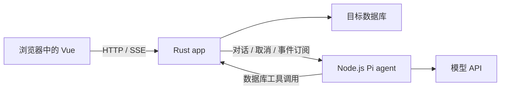

# Pi 接入与 Docker Compose 部署设计

状态：Rust、Vue、Pi 薄连接层和 Compose 骨架已实现。数据库执行、上传与写入计划仍为后续设计。当前接口和验证方式见 [开发与验证](development.md)。核对上游文档日期：2026-10-30。

## 技术结构

- **Vue**：简单单页 Web 应用，包含对话和数据库工作台。构建产物由 Rust 提供；浏览器通过同源 API 与 SSE 接收响应和任务事件。
- **Rust / Axum / Tokio**：管理连接、数据库凭据、文件解析、数据库适配、操作计划、写入确认、执行与记录。AI 与手写原生操作复用执行服务。
- **Node.js / Pi**：运行 Pi Agent 循环、模型调用、上下文和工具适配，将事件转发给 Rust。只维护必要的会话状态，不再实现数据库执行层、审批层或工作流引擎。

## Pi 选用方式

上游为 [earendil-works/pi](https://github.com/earendil-works/pi)，即原 badlogic/pi-mono。

优先使用 `@earendil-works/pi-agent-core` 和 `@earendil-works/pi-ai`。前者提供工具执行、状态管理与事件流，后者提供模型接口。这个组合适合注册数据库专用工具，不必携带完整 Coding Agent 的文件和终端工具。

直接复用 Pi 提供的 Agent 循环；薄服务只做请求转换、事件转发、会话装载与保存，以及调用 Rust 工具接口。对话持久化以 Rust 保存的应用记录为权威来源，Pi 活跃实例持有运行时上下文，避免两套持久化历史冲突。

如实现阶段发现必须使用 Coding Agent 的高级会话能力，可切换其 SDK，但应保持 Rust 边界不变，并显式配置可用工具。当前不引入自动发现的文件、终端工具或其他插件。

上游当前包说明要求 Node.js >= 22.19.0。本项目采用 Node.js 24+，已从 npm 安装 Pi 1.4.0，并提交锁文件。当前使用 Node 原生 TypeScript 类型擦除运行薄服务，额外进行类型检查。

## 薄连接层

采用内部 HTTP + NDJSON，Rust 对浏览器转发为 SSE，复用常规 HTTP 能力，不额外引入消息队列、服务注册中心、通用 RPC 框架或自研 Agent 编排。

骨架当前仅实现对话请求、断连取消、事件流和只读能力工具；下表中元数据、样本、查询、写入计划属于下一阶段。

拟定职责：

| 调用方向 | 接口职责 |
| --- | --- |
| Rust → Pi | 创建一次运行，携带会话 ID、用户消息、目标连接 ID、元数据及允许的样本 |
| Rust → Pi | 订阅运行事件、请求取消、读取运行状态 |
| Pi → Rust | 读取元数据、读取有界样本、执行受支持的只读查询 |
| Pi → Rust | 提交写入计划；返回计划 ID 与待确认状态，不在该工具调用中直接执行 |
| 浏览器 → Rust | 确认具体计划版本并执行；执行结果作为后续上下文交还 Pi |

写入确认绑定连接、目标对象、计划内容与版本。确认不采用长时间挂起的 Agent 工具调用；用户修改方案后重新验证。数据库查询是否只读由适配器按实际操作判断，不能仅凭工具名称或 SQL 首词推断。

所有请求关联 session_id、run_id；工具调用还关联 tool_call_id，执行任务关联 operation_id。事件至少区分文本增量、工具开始/结束、待确认计划、执行进度、错误与完成。

内部工具接口只接受 app 签发的运行上下文与内部认证，不接受模型提供的“已确认”声明。数据库凭据由 Rust 保存和使用，Pi 获取的只是连接引用和必要数据。接口不接受用户提供的任意回调地址。

同一连接上的有依赖写入按顺序执行。模型请求超时、Pi 取消和数据库取消分别记录；只有确认数据库停止后才显示操作已取消。

## Docker Compose

应用核心只有两个服务：

| 服务 | 作用 | 端口与数据 |
| --- | --- | --- |
| app | Rust API + Vue 静态资源 + 数据库执行 | 默认发布 `127.0.0.1:8080:8080`；应用状态、上传文件和执行记录使用持久化卷 |
| agent | 薄 Node.js 服务 + Pi | 只在容器网络监听，例如 3001；不配置宿主机 ports；模型凭据通过运行时配置注入 |

两个容器加入同一 Compose 默认 bridge 网络。app 使用 `http://agent:3001`，agent 使用 `http://app:8080` 访问经过认证的内部工具接口。容器内服务监听容器接口，不能只绑定容器自己的 127.0.0.1；固定 IP 不进入配置。

这里的“项目内网”是服务间使用私有 Docker 网络、内部服务不发布宿主机端口，**不是**将整个网络设置为 `internal: true`。Pi 需要连接模型 API，Rust 也可能连接外部数据库，默认 bridge 网络保留出站能力。

如果将来全部模型和数据库都在离线环境中，再根据实际环境增加完全隔离网络。MVP 不额外增加网关容器。

前端浏览器不能直接使用 Compose 服务名；只访问 app 发布的地址。默认本机发布，内网其他设备访问时显式配置宿主机绑定地址，并补齐对应的访问控制。

开发用数据库采用独立 profiles 和数据卷，按需启动。接入已有数据库时不需要启动九种数据库容器。容器中的 localhost 指向容器自身，连接宿主机数据库需要显式配置可达宿主地址。

健康检查分别检查 app 和 agent 自身就绪状态，不设置相互依赖的启动循环。Agent 失效不应阻止工作台使用数据库常规功能。

## 许可证

Pi 使用 MIT。仓库保留上游完整版权与许可证文本，见 [第三方声明](../THIRD_PARTY_NOTICES.md) 和 [Pi MIT](../LICENSES/pi-MIT.txt)。安装依赖后，根据最终锁定版本和发行内容补充其他第三方许可证。

## 官方依据

- [Pi Agent Core](https://github.com/earendil-works/pi/blob/main/packages/agent/README.md)
- [Pi Agent Core package.json](https://github.com/earendil-works/pi/blob/main/packages/agent/package.json)
- [Pi Coding Agent SDK](https://github.com/earendil-works/pi/blob/main/packages/coding-agent/docs/sdk.md)
- [Pi LICENSE](https://github.com/earendil-works/pi/blob/main/LICENSE)
- [Axum](https://docs.rs/axum/latest/axum/)
- [Vue 3](https://vuejs.org/guide/introduction.html)
- [Compose 服务发现与网络](https://docs.docker.com/compose/how-tos/networking/)
- [Compose network internal 属性](https://docs.docker.com/reference/compose-file/networks/)
